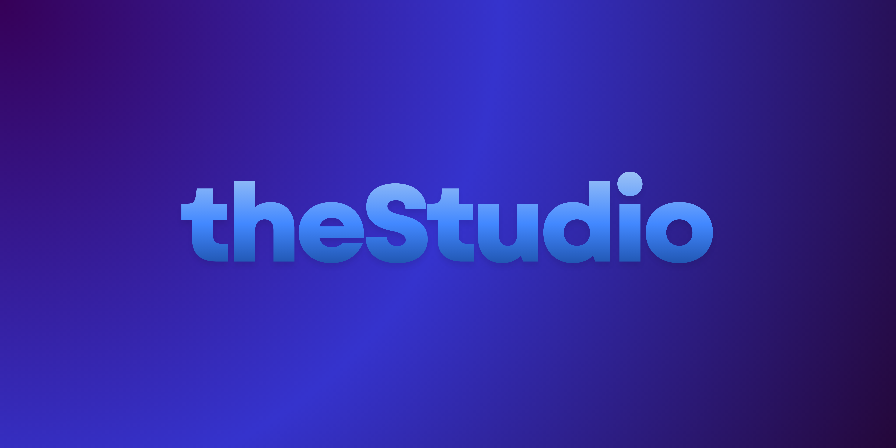

# theStudio

theStudio makes simple, clean, useful, native and fully open-source apps and mobile games.
Delivering a clean and practical user experience is the most important part of an app, yet many apps fail to do so.
Most apps these days are made using inefficient cross-platform frameworks or web wrappers, which often results in poor performance and excessive resource consumption. Many apps on the Play Store are filled with ads and most mobile games have annoying in-app purchases and are designed to extract as much money as possible out of the user.
Software should do what it's supposed to do: help the user accomplish something, not bother the user with bloat, in-app purchases and unnecessary ads. That is the main principle of theStudio: user experience always comes first.

## 🔗 Links
YouTube: https://www.youtube.com/@official._.theStudio

TikTok: https://www.tiktok.com/@thestudio._.official

## Projects
TBA
